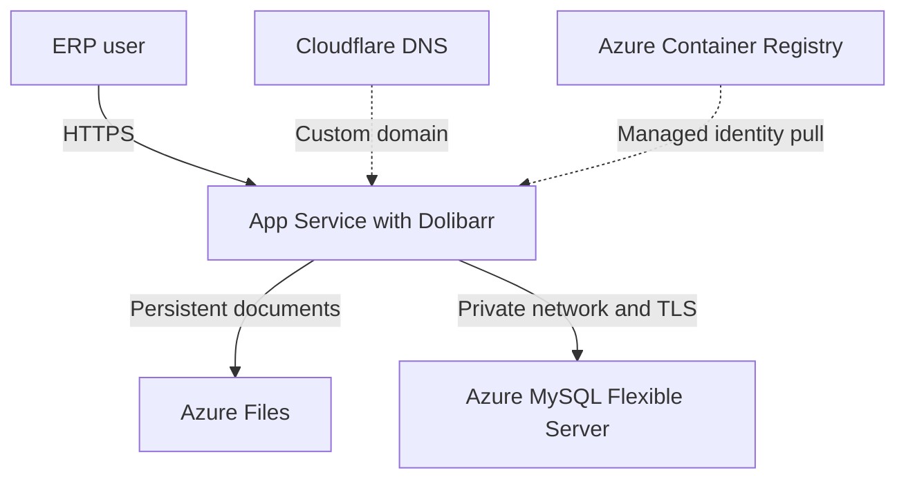
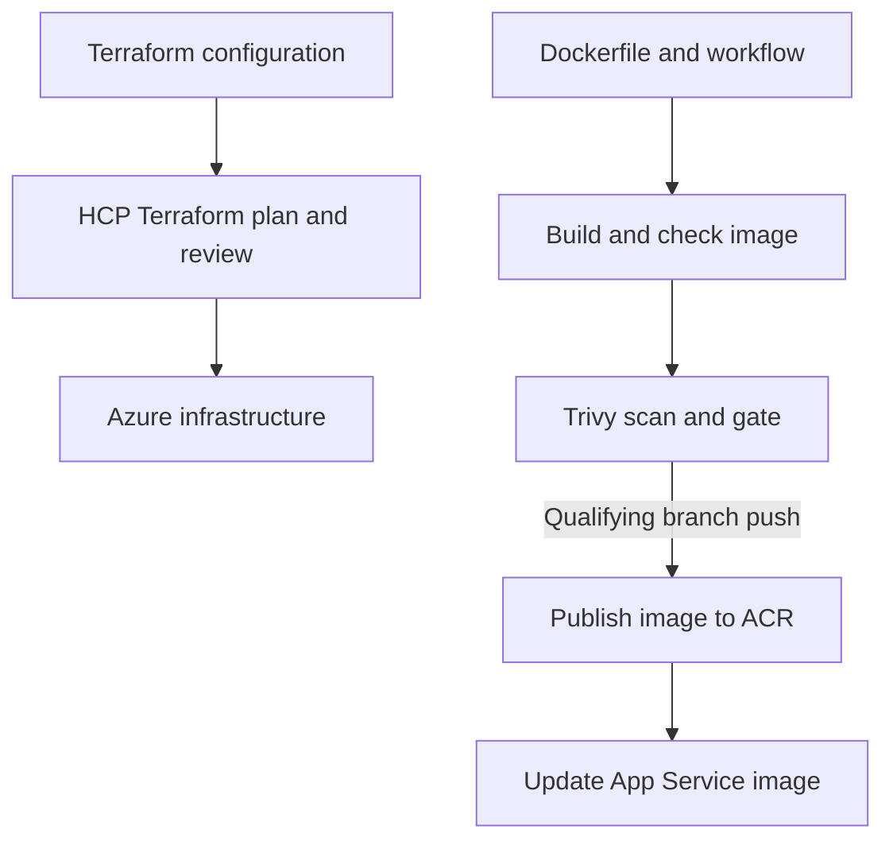
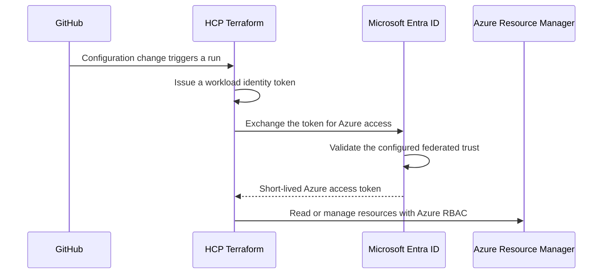
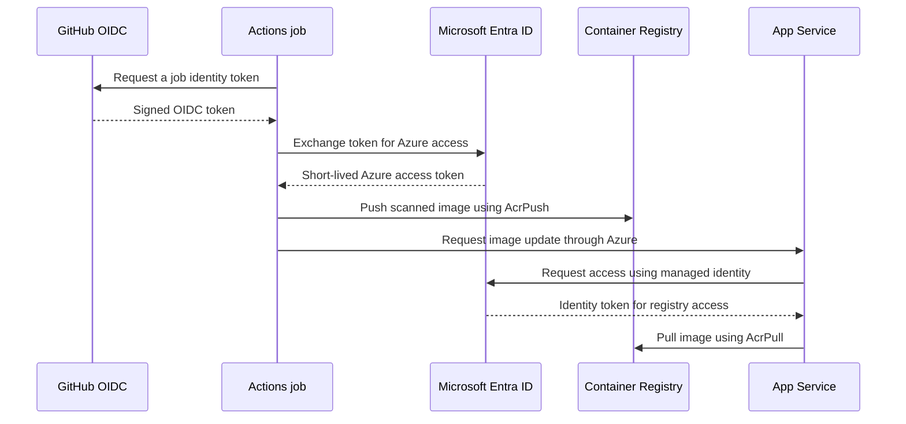

# Cloud ERP on Azure

**A Terraform and DevSecOps portfolio project inspired by real ERP operations**

I built a Dolibarr ERP lab on Azure to demonstrate how an enterprise application can be provisioned, connected to private data services, and delivered through a security-aware deployment pipeline. The project connects my ERP and systems administration experience with hands-on Azure, Terraform, Docker, and GitHub Actions work.

**[Technical deep-dive & runbook](doc/deployment-guide/Azure-Terraform-DevSecOps.md)** · **[Terraform](infrastructure/terraform)** · **[CI/CD workflow](.github/workflows/azure-dolibarr-image.yml)** · **[Example pipeline run](https://github.com/SilvaRohit/dolibarr/actions/runs/41671941720)**

> **Status:** Working, IP-restricted portfolio lab. Application and document access were verified after deployment. Database initialization errors and image scan findings remain under investigation; recovery, high availability, and capacity for 200 concurrent users have not been validated.

## Why this project

ERP services support daily operations: users need access to business records and documents, while IT teams need a dependable way to manage the infrastructure and release application changes. I wanted to explore that operational problem with a recognizable ERP application and a realistic cloud delivery workflow.

The goal was to keep the database off a public endpoint, separate documents from the container filesystem, manage infrastructure changes through Terraform, and make image build, security review, and deployment visible in GitHub Actions.

## Solution overview

**Application:** Dolibarr 24.0.2 runs as a custom Linux container on Azure App Service. Users access it through `erp.tecerotech.com`; inbound access is currently restricted to an administrative IP.

**Data:** App Service uses VNet integration and private DNS to reach Azure Database for MySQL Flexible Server. An Azure Files share is mounted at `/var/www/documents`. A storage private endpoint was not verified.

**Infrastructure:** Terraform defines the Azure resources. HCP Terraform stores state and runs reviewed plans against the `azure-terraform` branch.

**Delivery:** GitHub Actions builds and scans the image, publishes a commit-tagged image to Azure Container Registry, and requests an App Service update. Separate workload identities are used for Terraform, GitHub Actions, and App Service image pulls.

## What I implemented

| Challenge | Approach | Result in the lab |
| --- | --- | --- |
| ERP data services needed controlled connectivity | Separate delegated subnets, App Service VNet integration, private DNS, and private MySQL access | The app resolved the database to a private IP and connected over TLS. |
| Documents needed to persist across container deployments | Mounted an Azure Files share into the container | Document-directory writes and document access were verified. |
| Infrastructure needed a reviewable change process | Terraform configuration, HCP remote state, VCS-connected plans, and manual apply review | A post-deployment Terraform plan reported no infrastructure changes. |
| Container releases needed security checks | Image build, PHP syntax check, Trivy report, and a fixable-vulnerability gate | A deployment was stopped by the gate; the findings were investigated and scoped exceptions documented. |
| Deployment needed to avoid long-lived Azure client secrets | OIDC federation for HCP Terraform and GitHub Actions; managed identity for App Service registry pulls | The workflows authenticate to Azure using short-lived federated credentials. |
| Users needed a business hostname | Cloudflare DNS and Terraform-managed App Service domain and HTTPS bindings | The ERP was accessible over its custom domain. |

## How a change moves through the platform

Terraform manages the infrastructure; GitHub Actions manages the deployed image tag. A targeted Terraform lifecycle rule leaves that image attribute to the deployment workflow. I checked this handoff with a subsequent no-change plan.

The Dockerfile extends an official Dolibarr image and patches the MySQL driver to verify the server certificate. **It does not currently copy application source code from this fork into the image.** The workflow checks the image and patched PHP syntax; it is not a full application test suite.

## Identity and authentication flows

### HCP Terraform → Microsoft Entra ID → Azure

HCP Terraform initiates the Azure authentication. Entra ID trusts an HCP-issued token only when its issuer, audience, and exact workspace/run-phase subject match the configured credential. After authentication, Azure RBAC controls what the Terraform identity can do. The workspace uses separate trusted subjects for **plan** and **apply**. HCP stores the Terraform state; Azure does not initiate the HCP run.

### GitHub Actions → Microsoft Entra ID → Azure

GitHub Actions initiates the deployment authentication; Azure validates the GitHub-issued token against a **separate** Entra application and federated credential. The workflow identity has registry push and web app management roles. App Service then uses its own user-assigned managed identity to pull the image—its pull identity is separate from the GitHub deployment identity.

The [technical guide](doc/deployment-guide/Azure-Terraform-DevSecOps.md#identity-and-authentication-flows) explains the trust settings, role scopes, token flow, and troubleshooting in more detail.

## Evidence and troubleshooting

- **Network and database:** verified private DNS resolution, TCP connectivity, and a Dolibarr driver connection reporting an active TLS cipher.
- **Storage and application:** verified document-directory writes and, after deployment, application login and document access.
- **Delivery:** [a successful GitHub Actions run](https://github.com/SilvaRohit/dolibarr/actions/runs/41671941720) shows the image checks, security gate, ACR push, and App Service update request.
- **Identity:** resolved a GitHub OIDC login failure caused by a tenant/subscription ID mismatch; the subsequent Azure login test passed.
- **Database setup:** investigated MySQL-generated invisible primary keys conflicting with Dolibarr table initialization and managed the server setting with Terraform. The existing schema still requires investigation and correction.
- **Security review:** investigated seven findings reported from Composer metadata whose package directories were not found in the checked image; documented temporary, path-scoped exceptions and added an image check.

The technical guide explains the evidence and its limits, the implementation sequence, configuration ownership, operational checks, and troubleshooting.

## Current boundaries and next steps

This is a B1, single-instance learning environment with a burstable database—not a production-sized ERP platform. The fresh initialization logged SQL errors, including key and reference-data failures. Although the application works for the checks performed, **schema integrity is not yet established**.

The full image scan reported **360 HIGH and 8 CRITICAL package findings** in the observed run. The gate ignores unfixed findings and uses seven scoped Composer exceptions expiring **17 November 2026**; a green pipeline is not a clean security assessment.

Priorities are to resolve and retest database initialization, restore-test coordinated database and document backups, evaluate the outstanding image findings, add health checks and rollback, and demonstrate a clean rebuild and representative load test. Terraform state and local backups also require restricted access because sensitive values can be present in state.

## Technology and skills

**Azure:** App Service · MySQL Flexible Server · Azure Files · VNet integration · Private DNS · Container Registry · managed identity

**Delivery and security:** Terraform · HCP Terraform · GitHub Actions · Docker · OIDC · Trivy · TLS · Cloudflare DNS

**Operations:** ERP configuration · database connectivity · persistent documents · release troubleshooting · infrastructure review

---

Dolibarr is an [open-source ERP project](https://github.com/Dolibarr/dolibarr). This portfolio documents my Azure infrastructure, integration, deployment, and operational work; it does not claim authorship of the application.
