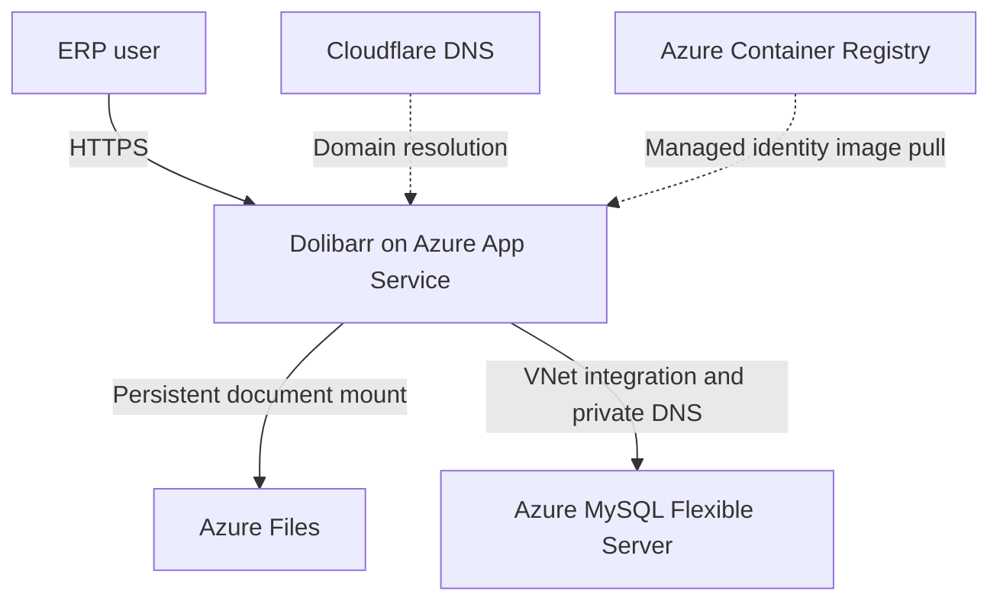

# Cloud ERP on Azure: Deployment, Recovery and Migration

**Business-focused Azure portfolio project | Dolibarr ERP and document management**

I deployed an open-source ERP application on Azure, recovered its data after a database container was reinitialized, and migrated the application to a managed database and persistent document storage. The project brings together ERP administration, cloud infrastructure, troubleshooting, and recovery.

> **Current status:** Working portfolio lab. The application, recovered users, and documents remained accessible after restart and removal of the old database container. Production availability and capacity for 200 concurrent users have not been validated.

## Business context

An ERP system supports day-to-day business processes by bringing records and documents together. Dolibarr provides functions for areas such as customers, products, quotations, invoices, and document management. This lab used Dolibarr to explore how an ERP service could be hosted and managed on Azure.

For a business, losing access to ERP records or supporting documents can interrupt operations. This project focuses on reducing a specific recovery risk: keeping business data tied to the lifecycle of an application container.

## The challenge and my response

| Challenge | What I did | Business value |
| --- | --- | --- |
| ERP data was no longer visible after the initial database container was reinitialized. | Recovered an existing SQL backup and documents archive, and compared selected records during the migration. | Restored access to the available backed-up data. |
| The database and documents initially depended on container-local storage. | Moved database records to Azure MySQL and documents to a mounted Azure Files share. | Data storage no longer relies on the original database sidecar or the application container's local filesystem. |
| The ERP application needed a controlled database connection. | Configured private network connectivity, DNS resolution, and a custom image with certificate verification. | Reduced public database exposure and added server identity verification for the tested connection. |
| Changes needed to survive an application restart. | Checked restored users and documents after restarts and removed the old MariaDB sidecar. | Demonstrated a more maintainable lab setup across the restart scenarios tested. |

The new architecture improves this specific lab setup. It does not establish a production recovery objective or guarantee against data loss.

## Solution overview

The web application uses a custom domain and HTTPS. ERP records are stored in Azure MySQL, reached through private networking. Documents are mounted from Azure Files. The storage connection was configured separately; a storage private endpoint was not verified.

### How the design evolved

The first lab placed a MariaDB database sidecar beside the application on App Service. Its database files had no persistent mount. Following the recovery, the application was switched to managed MySQL and the sidecar was removed.

The original and migrated network designs, exact settings, troubleshooting, and verification steps are documented in the [technical deep-dive](doc/deployment-guide/Azure-ERP-deployment-guide.md).

## Results

- Recovered a database containing **410 tables**; selected record counts matched between the local recovery database and the Azure MySQL import.
- Confirmed private DNS resolution and network connectivity from the application environment to the managed database.
- Tested the modified database driver's TLS verification using a valid hostname, a mismatched IP, and an untrusted CA.
- Verified recovered users and documents after App Service restart and removal of the old MariaDB sidecar.
- Created new database and document archives and checked archive integrity. A restore test of these newer backups is still pending.

These checks demonstrate the scenarios tested in the lab; they are not proof of production availability or 200-user capacity.

## Skills demonstrated

**ERP and operations:** application recovery, user and document verification, backup awareness, and migration planning.

**Azure and security:** App Service, Azure Database for MySQL Flexible Server, Azure Files, VNet integration, Private DNS, Azure Container Registry, managed identity, HTTPS, and database TLS.

**Troubleshooting:** diagnosing container persistence, resolving a MariaDB-to-MySQL collation incompatibility, and checking configuration against the running application.

## Next steps

- Test recovery from the latest backups and establish scheduled, independent document backups.
- Review access, secret management, monitoring, alerting, and image updates.
- Test real ERP workflows and MySQL collation behavior, then load-test representative users.
- Design and cost a production architecture with appropriate availability and recovery targets.

## Technical documentation

Read the [technical deep-dive](doc/deployment-guide/Azure-ERP-deployment-guide.md) for the two architecture diagrams, implementation sequence, configuration values, migration tests, and operational limitations.

[Dolibarr](https://github.com/Dolibarr/dolibarr) is an open-source ERP application. This portfolio documents my deployment, recovery, and infrastructure work; it does not claim authorship of the application.
