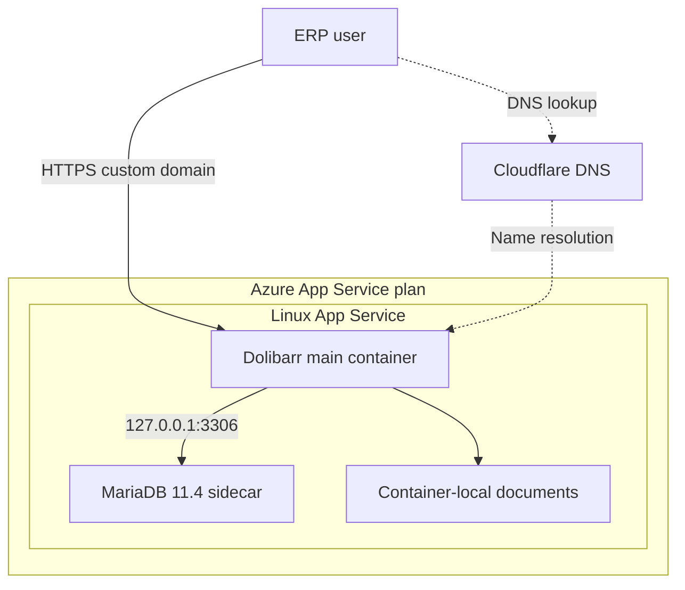
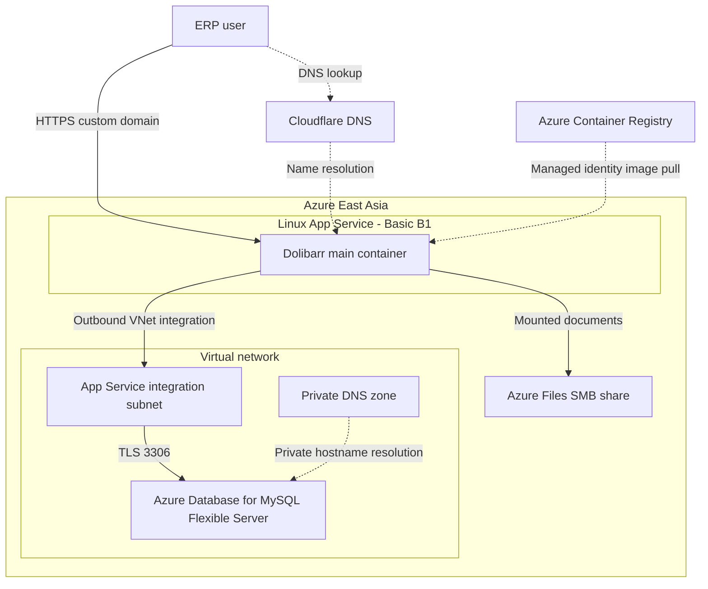

# Technical deep-dive: Azure ERP recovery and migration

**A hands-on cloud and ERP project:** recovered a Dolibarr installation after an ephemeral database was reinitialized, then migrated it to Azure Database for MySQL Flexible Server with private network access and Azure Files for persistent documents. The application, recovered users, and documents were verified after App Service restarts and removal of the old database sidecar.

**Technologies:** Azure App Service · Azure Database for MySQL · Azure Files · VNet integration · Private DNS · Azure Container Registry · Managed Identity · Docker · Cloudflare DNS · TLS · Azure Monitor

> **Scope:** Working portfolio lab, not a production deployment. The latest downloaded backups passed archive integrity checks but have not yet been restore-tested. High availability and capacity for 200 concurrent users have not been validated.

## System context and evidence

| | |
| --- | --- |
| **Problem** | The initial MariaDB sidecar used container-local storage. A container lifecycle change led to a fresh database and the original ERP data was no longer visible. |
| **My work** | Recovered the source backup, investigated database compatibility, built private connectivity, deployed a TLS-verifying application image, restored documents, and performed cutover and restart checks. |
| **Outcome** | Restored data was made accessible through Dolibarr on Azure MySQL and an Azure Files share. The local MariaDB sidecar and obsolete settings were then removed. |
| **Business context** | An ERP and document-management scenario chosen to reflect experience with enterprise application administration, infrastructure, and recovery. |

### Evidence from the lab

- Restored and compared a database containing **410 tables**; sample counts matched the local recovery database. Two users were present in the original recovery; additional data was added later.
- Verified private DNS and TCP connectivity to the managed database from the application environment.
- Tested the modified database driver's encrypted connection with a valid hostname; a mismatched IP and an untrusted CA were rejected in separate driver-level tests.
- Checked application-user access to the Azure Files document share, then confirmed recovered users and documents were accessible after app restart and sidecar removal.
- Created new database and document archives and checked that the archives could be read. A restore test of those newer archives remains outstanding.

The initial and migrated designs are shown below. Jump to [How the lab was built](#how-the-lab-was-built), [Recovery and migration](#recovery-and-migration), or [Remaining work](#remaining-work) for the technical details.

Dolibarr is an open-source upstream product. The work presented here is the Azure deployment, configuration, troubleshooting, and recovery; the application itself was not developed as part of this project.

## Architecture 1: Initial App Service lab



| Component | Initial design |
| --- | --- |
| Application | Dolibarr container on Linux App Service, using a Basic B1 plan. |
| Database | MariaDB 11.4 sidecar, accessed by the main container through `127.0.0.1`. |
| Database persistence | No persistent data mount was configured for the sidecar. |
| Documents | Initially on container-local storage, with no persistent document mount configured. |
| DNS and HTTPS | Cloudflare DNS, a custom domain, and HTTPS were configured during the lab. |

The containers shared an App Service environment. With no durable database mount, container replacement or restart could reinitialize the database; files stored only in the container were similarly at risk. This was a lab architecture, not a resilient ERP database design.

## Architecture 2: Recovered and migrated lab



| Component | Migrated design |
| --- | --- |
| Application | Dolibarr 24.0.2 on Linux App Service Basic B1. |
| Image | Custom image derived from the official Dolibarr image; hosted in Azure Container Registry and pulled with the App Service system-assigned managed identity. |
| Database | Azure Database for MySQL Flexible Server 8.4, private VNet access, restored schema `dolidb_restore_v2`. |
| Network | App Service VNet integration through its delegated subnet; database hosted in a separate delegated subnet and resolved using private DNS. |
| Database transport | Application uses an `ssl://` database host and a modified Dolibarr MySQL driver configured for CA and hostname verification. The database application user requires SSL. |
| Documents | Azure Files SMB share mounted at `/var/www/documents`; restored documents remained accessible after restart. The storage endpoint was not verified as a private endpoint. |
| Secrets | App Service settings hold configuration; database credentials and instance key are excluded from this repository. |
| Domain | Custom domain and HTTPS, with Cloudflare DNS. |

The managed database and the document share protect different parts of the workload. The private database connection uses VNet integration and private DNS; the Azure Files mount is a separate storage connection.

## How the lab was built

This is a manual deployment record, not a one-command installer. Azure portal labels and options can change; use the linked official documentation for current details. Resource names and domain values below are examples or descriptive labels: choose your own globally unique names and keep credentials out of Git.

### 1. Create the initial App Service lab

1. Sign in to Azure, select the intended subscription, choose a region in which the required services and SKUs are available, and set a budget alert. Check service prices and remaining credit separately.
2. Create a resource group and a Linux App Service plan. This lab used **East Asia** and a **Basic B1** plan.
3. Create an App Service with container and sidecar support. Configure the Dolibarr image as the main container and a MariaDB 11.4 image as a non-main container. The original lab used the official Dolibarr image; the later deployment used a versioned custom image.
4. Configure the application and MariaDB initialization settings with matching database name, username, and password. App Service sidecar containers share an environment and network; the Dolibarr connection used `127.0.0.1:3306` rather than a Docker Compose service name. Store real credentials securely and never commit them.
5. Configure the custom domain, create the DNS validation and routing records requested by App Service in Cloudflare, bind a valid certificate, and confirm HTTPS works. Record the DNS/proxy configuration separately because the precise records depend on the chosen hostname and setup.

**Initial limitation:** The database sidecar did not have persistent storage. Its data was lost from the active application after a container lifecycle change. Do not use this arrangement for important ERP data. Host paths in an upstream Docker Compose example are not automatically durable App Service mounts.

### 2. Preserve and verify recovery material

From Dolibarr, export a database dump and a documents archive. Store them outside the application, along with a protected copy of `conf.php` and the original instance identifier. Do not publish those files or values. The original SQL and documents archives were checked locally:

```bash
gzip -t /path/to/database-backup.sql.gz
tar -tzf /path/to/documents-backup.tar.gz > /dev/null
```

The original SQL dump was restored to an isolated local MariaDB recovery container before migration. Record the source version and compare representative counts from the source with the destination. Archive checks alone do not confirm that data can be restored.

### 3. Create private networking and the managed database

The actual lab used a VNet address space of `10.0.0.0/16` with separate, non-overlapping subnets:

| Purpose | Lab subnet | Delegation |
| --- | --- | --- |
| App Service outbound integration | `10.0.1.0/26` | `Microsoft.Web/serverFarms` |
| MySQL Flexible Server private access | `10.0.2.0/27` | `Microsoft.DBforMySQL/flexibleServers` |

1. Create or select a VNet in the appropriate region. Ensure its address space contains the two subnets and neither overlaps another subnet.
2. Create the App Service integration subnet. The lab used `/26`; review current App Service sizing and delegation requirements for a new deployment.
3. Create Azure Database for MySQL Flexible Server with **Private access (VNet Integration)**, the dedicated database subnet, and a linked private DNS zone. Choose a MySQL version and compute SKU appropriate for the workload and budget; this lab used MySQL 8.4.
4. In the App Service networking settings, configure **VNet integration** using the App Service subnet. Integration provides outbound connectivity to the VNet; it does not make the public web app private.
5. From the main container, verify that the database hostname resolves to a private IP, TCP port 3306 is reachable, and a database connection succeeds. Use the fully qualified hostname for certificate verification, not the private IP.

These actions can restart containers. Verify backups and plan for an interruption before changing a running app.

### 4. Restore the SQL dump to an isolated schema

1. In MySQL Flexible Server, create a **new, empty** recovery schema. Never import a recovery dump over a live schema. Connect using a client that can reach the private server and validates the server certificate.
2. Import the source dump into that test schema. The initial lab import failed because MariaDB's `utf8mb4_uca1400_ai_ci` table collation was unavailable on MySQL 8.4. A second import into a fresh schema used a targeted table-definition substitution from `utf8mb4_uca1400_ai_ci` to `utf8mb4_0900_ai_ci`, preserving the original archive. This change was specific to the observed dump, not a general-purpose compatibility conversion.
3. Compare table counts and representative records with the local recovery database. For example, after connecting to MySQL and selecting the restored schema:

   ```sql
   SELECT COUNT(*) AS table_count
   FROM information_schema.tables
   WHERE table_schema = DATABASE();

   SELECT COUNT(*) AS users FROM llx_user;
   SELECT COUNT(*) AS third_parties FROM llx_societe;
   SELECT COUNT(*) AS products FROM llx_product;
   ```

4. Check the Dolibarr install version in `llx_const`, and verify that the application image and database are compatible before allowing the application to connect. The recovered lab database and image both reported version 24.0.2.
5. Create a dedicated application database user restricted to the restored schema and requiring TLS. Use a strong secret entered privately. For this lab the user received schema-wide privileges; evaluate the minimum necessary privileges separately.

Count checks are only partial validation. Test actual records, document workflows, indexes, comparisons, sorting, and uniqueness under the target MySQL collation before trusting a production migration.

### 5. Build and deploy the TLS-verifying image

The official image version used in this lab had Dolibarr driver code that disabled certificate verification for its `ssl://` database connection. The lab built a derived image from the version-pinned official Dolibarr 24.0.2 PHP 8.5 image. Its build changed the driver to enable `MYSQLI_OPT_SSL_VERIFY_SERVER_CERT` and use `/etc/ssl/certs/ca-certificates.crt` as the CA bundle.

The project now has a `Dockerfile` in the `dolibarr-tls-image` folder. The commands below assume the folder is at the **repository root**, so the file is `dolibarr-tls-image/Dockerfile`. Its contents were not available for inspection when this guide was written: review the actual Dockerfile, its base image, and any files referenced by `COPY` before building or publishing. Ensure the build context contains no secrets, backup archives, or private configuration.

1. Review the upstream driver at the exact image version. Build a derived image for the platform required by App Service and check the changed source and PHP syntax. Pin image versions and, where appropriate, digests.
2. Test the actual patched driver against the database hostname: verify connection and cipher, then confirm a hostname mismatch and untrusted CA are rejected. Do not use a successful TCP connection as proof of TLS verification.
3. Push the image to a private Azure Container Registry. Enable the App Service's system-assigned identity and give it the pull permission appropriate to the registry's authorization mode.
4. Update the **main** App Service container to the custom registry image using that identity. Wait for deployment; the desired image setting and the running image may differ during an update.
5. In a new main-container shell, confirm the expected driver lines are present. Validate the live app after cutover. Retest the patch whenever the base image changes.

#### Build the image from the project folder

The lab used a Linux AMD64 image for App Service. From the repository root, an example rebuild with a **new tag** is:

```bash
test -f dolibarr-tls-image/Dockerfile

docker build --platform linux/amd64 \
  -t dolibarr-tls:24.0.2-php8.5-rebuild-1 \
  ./dolibarr-tls-image
```

Use a new versioned tag for each rebuild instead of overwriting the image referenced by a running app. The build context is `dolibarr-tls-image`; if the Dockerfile references files outside that folder, the context or Dockerfile must be adjusted after review. The resulting image must be tested rather than assumed identical to the previously deployed image.

Inspect the built image without starting the application:

```bash
docker run --rm --platform linux/amd64 --entrypoint /bin/sh \
  dolibarr-tls:24.0.2-php8.5-rebuild-1 -c \
  'grep -nE "SSL_VERIFY_SERVER_CERT|ssl_set" /var/www/html/core/db/mysqli.class.php &&
   php -l /var/www/html/core/db/mysqli.class.php &&
   test -r /etc/ssl/certs/ca-certificates.crt'
```

Check the printed driver lines against the intended patch. A source and syntax check is not a live TLS test: separately test a trusted hostname, a mismatched hostname or IP, and an untrusted CA against a safe test database before deployment.

#### Publish a verified rebuild

Once the rebuild has been reviewed and tested, it can be published under the new tag. Set `ACR_NAME` to the registry's **resource name**, not its login-server address:

```bash
ACR_NAME="YOUR_ACR_NAME"
ACR_LOGIN_SERVER=$(az acr show --name "$ACR_NAME" --query loginServer --output tsv)
az acr login --name "$ACR_NAME"

docker tag dolibarr-tls:24.0.2-php8.5-rebuild-1 \
  "$ACR_LOGIN_SERVER/dolibarr-tls:24.0.2-php8.5-rebuild-1"

docker push "$ACR_LOGIN_SERVER/dolibarr-tls:24.0.2-php8.5-rebuild-1"
```

Publishing creates a registry image and may incur registry charges; it does not update the web app. Updating the App Service main container to a new image is a separate deployment that can cause interruption. Retain the previously working image and deployment settings for rollback. The image built by this example and these rebuild commands have not been tested in this documentation environment.

### 6. Restore persistent documents

1. Create a storage account and an Azure Files SMB file share. Review the storage account's network access and security configuration; this lab did not verify a storage private endpoint.
2. In the App Service storage/path-mapping settings, add the file share as an Azure Storage mount. The lab first mounted it at a temporary path to verify access before mapping it to `/var/www/documents`. The mount configuration uses storage credentials; do not print or commit storage keys.
3. Inspect the archive structure before extraction. The lab archive had a top-level `documents/` folder, so restoring it required stripping that leading directory. Restore to an empty test mount, not on top of an active data set, and preserve the source archive.
4. Check that the web server user can read a known document and create and remove a test file on the share. Confirm `install.lock` is present where appropriate for the recovered installation.
5. Configure the final mount at `/var/www/documents`, reconnect to the new container after the app restarts, and confirm `df -hT /var/www/documents` reports the expected Azure Files mount.

File-share snapshots protect specific points in time, while share soft delete protects against deletion of the share. Maintain an independent backup and do not assume a share snapshot backs up MySQL.

### 7. Cut over to the recovered database

Before changing a live app, preserve a current database and document backup and note the rollback settings. In App Service **Environment variables**, the recovered lab used these settings:

| Setting | Recovery value |
| --- | --- |
| `DOLI_DB_HOST` | Azure MySQL fully qualified hostname, without `ssl://` |
| `DOLI_DB_HOST_PORT` | `3306` |
| `DOLI_DB_NAME` | Restored schema name |
| `DOLI_DB_USER` / `DOLI_DB_PASSWORD` | Dedicated application account and its secret |
| `DOLI_DB_TYPE` / `DOLI_DB_SSL` | `mysqli` / `true` |
| `DOLI_INSTALL_AUTO` | `0` for this recovery cutover |
| `DOLI_URL_ROOT` | Full HTTPS custom-domain URL |
| `DOLI_INSTANCE_UNIQUE_ID` | Original instance identifier, kept private |

Apply the settings together and allow for an app restart. The image generates `conf.php` only under certain conditions: changing environment variables does not guarantee an already-existing configuration file is rewritten. Inspect the active config without printing its password or instance key. In this lab the active host began with `ssl://`, and the schema, user, and document path matched the intended settings.

Sign in with a restored user, check users and business records, and open an existing DMS document. Restart App Service and repeat the checks. Once the app is confirmed to be using the managed database, remove the old MariaDB sidecar and, after verification, its obsolete `MYSQL_*` settings. Do not remove the `DOLI_DB_*` settings.

### 8. Record evidence and operating limits

Record redacted screenshots or outputs showing the private DNS result, database connection, image verification, file mount, application checks, and plan metrics. Do not include tenant IDs, passwords, access keys, confidential documents, or customer data in public artifacts.

The lab tested the original recovery and restart persistence. It did not verify a restore of the latest archives, automatic Azure Files backups, production high availability, or 200 concurrent users. Those remain separate validation tasks.

## Recovery and migration

1. **Identify the failure mode.** The original MariaDB sidecar used container-local storage. Following a container lifecycle change, a fresh database was initialized and the original ERP records were no longer visible.
2. **Preserve the recovery inputs.** Downloaded the original SQL dump and document archive, checked archive integrity, and preserved the original Dolibarr configuration and instance identifier securely.
3. **Validate the source.** Restored the original SQL dump to an isolated local MariaDB recovery container. The recovered schema contained 410 tables; sample row counts were compared during migration.
4. **Provision private MySQL.** Created Azure Database for MySQL Flexible Server in its own delegated subnet and integrated App Service with a separate subnet. Validated private DNS resolution and TCP connectivity.
5. **Address database compatibility.** An initial import failed because MySQL did not recognize MariaDB's `utf8mb4_uca1400_ai_ci` collation. A fresh test schema was imported after a targeted substitution of the table collation to MySQL's `utf8mb4_0900_ai_ci`. The original dump was retained unchanged. These collations can differ in sorting and equality, so row counts alone do not establish full compatibility.
6. **Validate restored data.** The imported schema had 410 tables. User and selected business-record counts matched the local recovery database; restored user and DMS content were then checked through Dolibarr.
7. **Protect and restore documents.** Mounted an Azure Files share, restored the document archive, and checked readability and writability for the web application user. The final mount was placed at `/var/www/documents`.
8. **Harden database TLS.** Built and published a controlled Dolibarr image with a modified `mysqliDoli` driver to enable server certificate verification using the system CA bundle. Driver-level tests succeeded with the database hostname and rejected both a mismatched IP address and an untrusted CA. The patched code was verified in the running container.
9. **Cut over and verify.** Configured the application to use the managed MySQL schema and persistent document path. Disabled automatic installation and kept the original instance identifier. Verified the restored users and files remained accessible after an App Service restart.
10. **Remove the sidecar.** Removed the MariaDB sidecar and its `MYSQL_*` app settings. Verified the app and documents again after restart.

## Technical investigation and validation details

This section records the observed lab state and commands useful for inspection. Replace example names with your own. Read-only checks are labelled; Azure configuration changes and imports can cause interruption or data loss and require a recovery plan.

### Container lifecycle and data boundaries

| Layer | Initial state | State after cutover |
| --- | --- | --- |
| Application | Main App Service container; upstream Dolibarr image | Main App Service container; versioned custom image |
| Database | MariaDB 11.4 sidecar; no configured persistent database mount | MySQL Flexible Server 8.4, private VNet access |
| DB endpoint | `127.0.0.1:3306` | MySQL server FQDN, private DNS, TCP 3306 |
| Documents | Container-local `/var/www/documents` | Azure Files SMB share mounted at `/var/www/documents` |
| Recovery | Original SQL and document archives plus protected configuration | Recovered SQL schema and document archive, plus newer downloaded archives |

The main and sidecar containers share a network namespace in this App Service configuration. `127.0.0.1` referred to the sidecar connection in the original deployment; it is not the managed MySQL endpoint. VNet integration is outbound and does not itself remove the application's public endpoint.

### Database import: observed compatibility issue

The original dump was made by MariaDB 11.4. Its table definitions contained `COLLATE=utf8mb4_uca1400_ai_ci`, which the MySQL 8.4 target rejected with `ERROR 1273: Unknown collation`. A later import into a **different, empty schema** succeeded after replacing that collation on matching table-definition lines. The original archive was not modified.

The transformation below documents the lab's targeted pattern. It writes a sensitive **uncompressed** SQL copy; use protected temporary storage, verify the paths, and do not commit it. It is not a universal migration tool, and schemas, stored objects, and data may need other changes.

```bash
# Set these two paths privately before running; do not overwrite the source.
# DOLI_SOURCE_ARCHIVE=/path/to/original-dump.sql.gz
# DOLI_MIGRATION_SQL=/secure/path/to/transformed-copy.sql
set -o pipefail
umask 077
gzip -dc "$DOLI_SOURCE_ARCHIVE" \
  | sed '/^[[:space:]]*)[[:space:]]*ENGINE=/s/COLLATE=utf8mb4_uca1400_ai_ci/COLLATE=utf8mb4_0900_ai_ci/g' \
  > "$DOLI_MIGRATION_SQL"
```

Use an isolated schema, a private-network-capable database client, and verified TLS to import the transformed copy. Check errors before comparing the source and target. No automated import script is supplied here; the data transfer to the private network and credentials must be arranged securely. Delete the temporary SQL copy when it is no longer needed under the applicable retention policy.

`utf8mb4_uca1400_ai_ci` and `utf8mb4_0900_ai_ci` are not equivalent. Confirm ordering, case and accent comparisons, and unique indexes against realistic ERP data. A successful import or equal row count is not proof of application-level equivalence.

### TLS verification: what was changed and tested

The original `mysqliDoli` branch checked during this lab explicitly disabled certificate verification. The custom 24.0.2 image changed these two lines in `/var/www/html/core/db/mysqli.class.php`:

```php
parent::options(MYSQLI_OPT_SSL_VERIFY_SERVER_CERT, 1);
parent::ssl_set(null, null, "/etc/ssl/certs/ca-certificates.crt", null, null);
```

The live container was checked for these lines. Separate driver-level tests connected by server hostname using TLS and rejected connections using the private IP as the expected hostname or using an unrelated CA. These checks support the driver-level result; they are not a full penetration test. A `dolibarr-tls-image/Dockerfile` has since been added to the project; its contents and exact location were not inspected while updating this guide. Do not assume the same patch applies unchanged to another Dolibarr version.

### Read-only configuration checks

On the machine authenticated to the correct Azure subscription, list container configuration without printing credentials:

```bash
az webapp sitecontainers list \
  --resource-group YOUR_RESOURCE_GROUP \
  --name YOUR_WEBAPP_NAME \
  --query '[].{Container:name,Image:image,Main:isMain,MountPaths:volumeMounts[].containerMountPath}' \
  --output table
```

The image in the site-container configuration is the desired setting; inspect the running container or status separately to verify what is active. In a shell connected to the **current main container**, the following checks do not display the database password:

```bash
df -hT /var/www/documents

grep -nE 'SSL_VERIFY_SERVER_CERT|ssl_set' \
  /var/www/html/core/db/mysqli.class.php

php -r '
include "/var/www/html/conf/conf.php";
echo "DB host: ", $dolibarr_main_db_host ?? "not set", PHP_EOL;
echo "DB name: ", $dolibarr_main_db_name ?? "not set", PHP_EOL;
echo "DB user: ", $dolibarr_main_db_user ?? "not set", PHP_EOL;
echo "Documents: ", $dolibarr_main_data_root ?? "not set", PHP_EOL;
'
```

The lab's active host began with `ssl://`, its database name pointed to the restored schema, and `df` showed the Azure Files share. Reconnect after a restart: an old shell may refer to an older container. Avoid sharing complete `conf.php`, environment variable lists, storage mount configuration, or unredacted logs.

### Validation sequence and boundaries

1. The original archive passed gzip/tar integrity checks. Original SQL was restored locally to MariaDB before attempting the MySQL import.
2. The restored MySQL schema contained 410 tables; the original recovery had two users. Selected source and target counts matched. Additional users and DMS files were added later.
3. The main image and database reported Dolibarr 24.0.2. The application user connected over TLS, and the patched driver's positive and negative verification tests were performed independently.
4. Restored documents were readable and writable by the web user. Users and a DMS document remained accessible after restart and removal of the sidecar.
5. New SQL and document backups were downloaded after later changes and passed archive integrity checks. Their restoration has **not** been tested. A seven-day MySQL retention setting and earliest restore date were reported, but no MySQL restore was executed at that stage.

The SQL and document backups are separate artifacts and must be coordinated for an ERP recovery. A file-share snapshot is point-in-time and remains dependent on its source share. MySQL server backups do not cover Azure Files documents.

## Recovery and security controls

- **MySQL:** Azure reported a seven-day backup retention period and an earliest restore date. Geo-redundant backup was disabled. A restore would create a separate server; no new Azure restore server was created as part of this check.
- **Documents:** Azure Files share soft delete was set to seven days, and a manual share snapshot was created. Share soft delete protects against deletion of the share, while a snapshot can help recover individual files; neither replaces an independent backup.
- **Independent archives:** New SQL and document archives were downloaded after additional users and DMS files were added. Archive integrity checks passed; restoration of those newer archives has not yet been tested.
- **Encryption identity:** The existing Dolibarr instance identifier was retained. The original configuration and credentials are sensitive recovery material and must not be committed.
- **Least privilege:** A dedicated `dolibarr_app` database user was scoped to the restored schema and required SSL. Its broad schema privileges should be reviewed before any production deployment.
- **Image access:** The application uses a managed identity to pull from the private container registry. The custom image patch must be reviewed and retested for every Dolibarr update.

## Observability and cost

App Service plan CPU and memory metrics and web-app HTTP server error metrics were reviewed as an initial baseline. The database, storage, registry, networking, and application should be monitored together; a quiet lab baseline is not a capacity test.

The subscription has a budget alert, but a budget is not a hard spending cap. App Service, MySQL, storage, registry, backups, and monitoring can have different charges. Check actual usage and credit eligibility for the subscription before extrapolating costs.

## Evidence to add to this repository

The results described above are from the lab checks. The following supporting artifacts can be added after reviewing and redacting them; they are not included in this document yet.

| Artifact | What it would demonstrate |
| --- | --- |
| Redacted Dolibarr application and DMS screenshots | Application access and restored document visibility. Use fictional or approved data. |
| App Service network integration and MySQL networking screenshots | Integration subnet, private database access, and DNS design. |
| Redacted mount and connection output | The document share is mounted and the target database is reachable. Exclude secrets and unnecessary internal identifiers. |
| CPU, memory, and HTTP error charts | The initial monitoring baseline and the period measured. |
| Reviewed, version-controlled Dockerfile and build notes | The TLS-verification modification and how to reproduce and review the image. The `dolibarr-tls-image` folder has been added locally; confirm it is reviewed and tracked before publishing. |
| Restore-test record | Recovery steps, validation results, and timing for a future test of the latest backups. |

Remove credentials, account keys, instance identifiers, customer data, subscription identifiers, and sensitive URLs from all public evidence. Screenshots alone do not prove production readiness.

## Remaining work

- Restore-test the latest database and documents backups in an isolated environment, and document recovery time and data loss windows.
- Establish a scheduled, independent backup and retention plan for Azure Files; align database and document recovery points.
- Review database permissions, secret management, administrator access, and a safe image upgrade process.
- Add appropriate health checks, alerts, and logging; validate the monitoring costs and retention settings.
- Test real ERP workflows and MariaDB-to-MySQL collation differences, particularly comparisons, sorting, and unique constraints.
- Load-test representative authenticated ERP and DMS workflows with agreed response-time and error-rate targets before estimating user capacity.
- Assess high availability, scaling, disaster recovery, and cost for a production design. A single B1 lab does not establish production readiness.
- Manage the configuration as code and record reproducible deployment and rollback procedures.

## Technology and references

- [Dolibarr](https://github.com/Dolibarr/dolibarr)
- [Official Dolibarr container image](https://github.com/Dolibarr/dolibarr-docker)
- [Azure App Service VNet integration](https://learn.microsoft.com/en-us/azure/app-service/overview-vnet-integration)
- [Azure Database for MySQL backup and restore](https://learn.microsoft.com/en-us/azure/mysql/flexible-server/concepts-backup-restore)
- [Azure Files data protection](https://learn.microsoft.com/en-us/azure/storage/files/files-data-protection-overview)

This document describes a portfolio lab, the observed recovery steps, and known limitations; it is not a complete production runbook.
