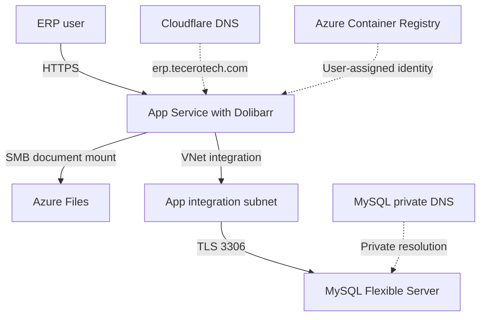
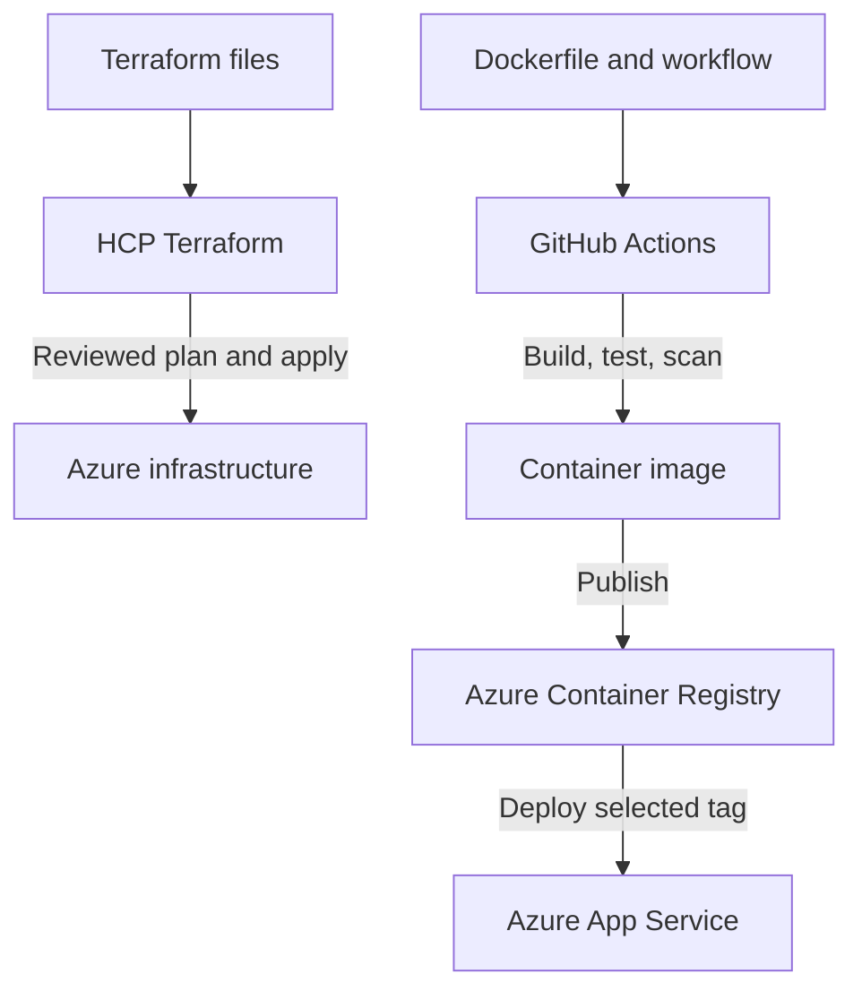
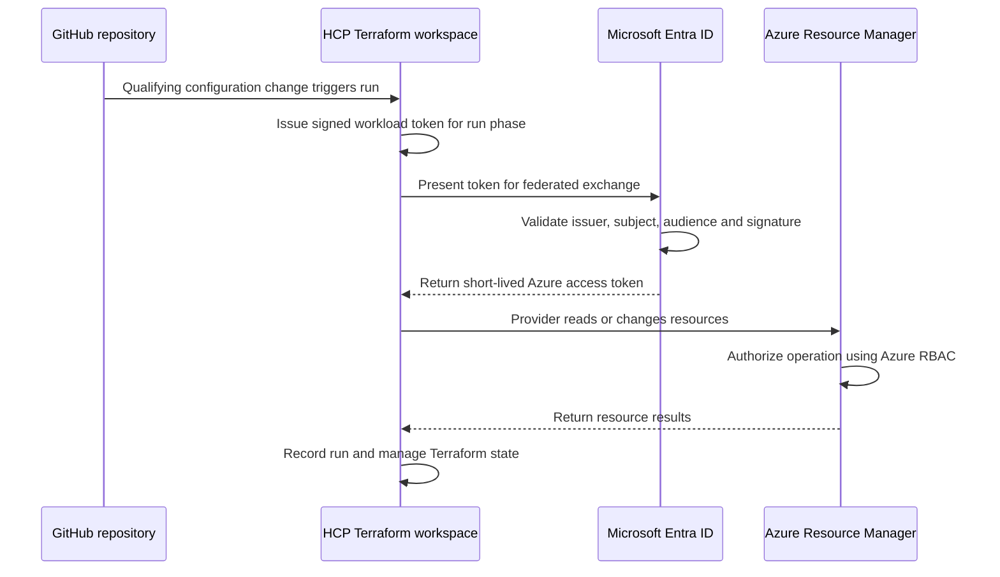
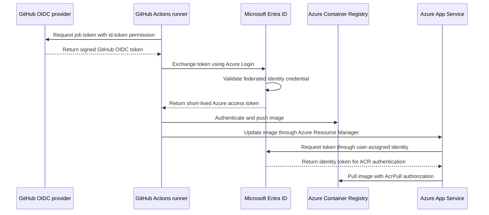

# Technical deep-dive: Dolibarr ERP on Azure with Terraform and GitHub Actions

This document explains the Terraform-based lab from infrastructure provisioning through application deployment and validation. It complements the business-focused [project README](../../README.md).

> **Scope and status:** This is a working learning environment, not a production reference deployment. Configuration and results describe the implementation inspected on the `azure-terraform` branch and the checks reported during the lab. A clean end-to-end rebuild, production recovery, high availability, and 200-user capacity are not yet proven.

## 1. Project goals and boundaries

The goal was to run a fresh Dolibarr ERP on Azure, manage the infrastructure with Terraform and HCP Terraform, and build a separate GitHub Actions workflow for the container image. The work brings together ERP administration, container deployment, private networking, persistent storage, identity federation, security scanning, and operational verification.

The lab uses an existing public Dolibarr container as its starting point. The repository's custom Dockerfile patches the image's MySQL driver; it does **not** build the Dolibarr application source from this fork. The image pipeline is therefore a container integration pipeline rather than a CI pipeline for repository application-code changes.

### Architecture



The App Service has IP access restrictions and remains an internet-facing service; VNet integration supplies outbound access to the private database. The Azure Files mount is a separate storage connection. A private endpoint for that storage account was not verified.

### Delivery responsibilities



## 2. Implemented resources

| Area | Lab implementation |
| --- | --- |
| Region and resource group | East Asia; `dolibarr-rg` |
| Application | Linux App Service `dolibarr-application`; Basic B1 plan |
| Container registry | Azure Container Registry Basic; admin account disabled; legacy registry-permission mode |
| Container identity | User-assigned managed identity with `AcrPull` at registry scope |
| Virtual network | `vnet-dolibarr`, `10.1.0.0/16` |
| App integration subnet | `10.1.1.0/26`, delegated to `Microsoft.Web/serverFarms` |
| Database subnet | `10.1.2.0/27`, delegated to `Microsoft.DBforMySQL/flexibleServers` |
| Private DNS | MySQL private DNS zone linked to the VNet |
| Database | Azure Database for MySQL Flexible Server 8.4, `B_Standard_B1ms`, 20 GB configured storage, 7-day retention, geo-redundant backup disabled |
| Active database | `dolidbretry`; Terraform address `azurerm_mysql_flexible_database.main` |
| Documents | `dolibarr-documents` Azure Files SMB share, quota 32 GB, mounted at `/var/www/documents` |
| DNS and HTTPS | `erp.tecerotech.com`, Cloudflare DNS, App Service managed certificate and SNI binding |
| Access | App Service main and SCM endpoints use a temporary administrative IP allow rule; default action is deny |

The database name contains `retry` because it was created during installation troubleshooting. A Terraform `moved` block changed the **resource address** from `retry` to `main`; it did not rename the Azure database. Renaming or replacing the database would have different data implications.

## 3. Prerequisites and operating assumptions

- An Azure subscription with the required resource availability and quota in the selected region.
- A registered domain with permission to manage its Cloudflare DNS records.
- An HCP Terraform organization and workspace, plus access to Azure to configure workload identity federation and role assignments.
- A GitHub fork, a branch for the lab, and permission to enable and administer Actions.
- Terraform, Azure CLI, Docker, and Git on the operator's workstation. The lab built Linux AMD64 images.
- A cost plan for the App Service plan, MySQL compute and storage, registry, storage, DNS, monitoring, and bandwidth. The lab used a budget alert; a budget alert is not a spending cap. Check the current rates and credit terms for the actual subscription.

**Rebuild boundary:** The repository is not a one-command, fully bootstrapped ERP installer. HCP Terraform's Azure identity, its federated credentials, and some role assignments were configured separately. The MySQL application user was created manually. The container image must exist in the registry before the app can pull it, and DNS/certificate validation requires external coordination. A clean rebuild of this exact configuration has not been demonstrated.

## 4. Terraform configuration and state

The Terraform configuration is in [`infrastructure/terraform`](../../infrastructure/terraform). It declares the resource group, network, subnets, DNS, database, storage, registry, identities, App Service, custom hostname, and certificate resources. The provider lock file records the selected provider version; the lab used AzureRM 4.81.0.

Terraform was initially run locally. Existing local state was then migrated to the HCP Terraform workspace `dolibarr-infra` in organization `tecerotech`. The workspace was connected to this fork's `azure-terraform` branch, with `infrastructure/terraform` as its working directory and manual apply review.

The VCS-connected workspace uses its committed configuration for normal runs. A clean plan was observed after application deployment, showing that the image handoff did not cause a proposed rollback at that time. Review every plan independently; a past no-change plan does not guarantee a future one.

### Identity and permissions

HCP Terraform authenticates to Azure using a Microsoft Entra application and **dynamic OIDC credentials**. Separate federated identity subjects were configured for the workspace's plan and apply phases. The workspace uses the standard HCP Azure dynamic-credential environment variables along with the tenant and subscription identifiers.

The lab assigned Contributor at the resource-group scope. Contributor alone does not grant role-assignment write permission, and a role scoped to an existing resource group cannot create that group after deletion. Rebuilding from nothing requires a deliberate bootstrap identity and appropriately scoped permissions for resource creation and role assignments. Do not silently broaden permissions to solve a failed apply.

### Variables and state protection

Workspace Terraform variables include resource names, region, administrative CIDR, database administrator credentials, application database credentials, the Dolibarr instance identifier, and the initial application administrator password. Secret values were configured as sensitive in Terraform/HCP; no values belong in the repository.

**Sensitive does not mean absent from state.** The implementation uses normal password attributes, app settings, and a storage account access key, which can be present in Terraform state. Restrict HCP state access and secure any local state backups or plan files. The Terraform directory's `.gitignore` excludes local working files, state, plans, and variable files; `.terraform.lock.hcl` remains tracked. A `.terraformignore` controls CLI upload contents separately from Git ignore rules.

**Working-directory caution:** With an HCP workspace working directory configured, a CLI-driven run may upload parent-directory contents. Review `.terraformignore` at the correct upload root before using CLI-driven runs; prefer the established VCS workflow for managed changes. Never publish state, backup archives, access tokens, passwords, or private configuration.

## 5. Network and private database

The VNet uses non-overlapping application and MySQL subnets. The App Service integrates with the delegated app subnet to reach the VNet. MySQL Flexible Server uses the separately delegated database subnet and private DNS. The lab's Azure configuration reported database public access disabled.

From the App Service environment, the MySQL hostname resolved to a `10.1.2.x` private address and a TCP connection on port 3306 succeeded. The database's fully qualified hostname—not its private IP—is used for TLS certificate identity checking.

The application MySQL user was created separately with `REQUIRE SSL` and schema-level privileges. A connection using that user was verified, and the Dolibarr driver reported a TLS cipher. The user and its grants are not currently provisioned by Terraform. Review the privileges before any production use; the lab grant was broad within its schema.

### MySQL initialization issue

During a fresh installation, MySQL's `sql_generate_invisible_primary_key` setting was ON. Dolibarr creates some keys after creating the tables, and Azure-generated invisible keys caused conflicts. The setting was changed to OFF through Terraform and a new session confirmed it was OFF.

The installation attempt nevertheless logged **26 SQL errors**, including duplicate/multiple key errors and a reference-data foreign-key failure. Some tables created earlier contained a generated `my_row_id`; changing the server setting did not repair existing tables. A duplicate region code in the shipped data was also observed. The resulting schema had 410 tables, an active administrator, and application access worked, but those facts do **not** establish a clean installation or schema integrity.

Before treating the application as reliable, investigate and resolve the keys and reference data in an isolated environment, reproduce a clean installation, and test ERP workflows and data integrity. Do not reset the live schema or rerun the installer without a recovery plan.

## 6. Persistent documents and recovery

An Azure Files share is mounted at `/var/www/documents`. The application user was able to create and remove a test file, and the user reported that documents were accessible after deployment. This separates documents from the writable container filesystem.

The Terraform storage configuration includes a seven-day share retention policy. Share soft delete, share snapshots, database automated backups, and independent backups protect against different failures; none alone proves end-to-end ERP recovery. The MySQL server is configured with seven-day backup retention and no geo-redundancy.

**Outstanding:** Establish the actual backup schedule and retention for both the current database and file share, define recovery objectives, retain copies in an appropriate location, and perform a coordinated restore test. Do not claim that the current ERP's latest backups have been restored successfully without evidence.

## 7. Custom container and TLS

The [`dolibarr-tls-image/Dockerfile`](../../dolibarr-tls-image/Dockerfile) starts from `dolibarr/dolibarr:24.0.2-php8.5`. It checks the expected driver source, modifies `mysqli.class.php` to enable server-certificate verification and use the system CA bundle, and runs PHP syntax validation. These build checks are version-specific and deliberately fail if the expected upstream source changes.

The image is built for `linux/amd64`, pushed to ACR, and pulled by App Service using its user-assigned identity. The application configuration uses the MySQL hostname, a dedicated database user, TLS, a stable instance identifier, and the Azure Files document path. Automatic installation is disabled in the current configuration.

The application successfully connected through the patched driver and reported a TLS cipher. A syntax check and an encrypted connection are useful evidence, but neither alone proves all certificate-verification behavior for every future image. Revalidate the actual image and TLS behavior when the base image or driver changes.

The upstream image uses a version tag rather than a pinned digest. Tags can move, so a future rebuild may use different upstream bytes even if this repository does not change. Pinning a reviewed digest and establishing a controlled base-image update process are open improvements.

## 8. GitHub Actions: build, security, and release

The [`Azure Dolibarr Image CI`](../../.github/workflows/azure-dolibarr-image.yml) workflow performs these steps:

1. Check out the repository with read-only content permissions.
2. Build the custom image for Linux AMD64.
3. Check PHP syntax in the patched driver.
4. Check a Composer metadata fingerprint and search for specific package directories under `/var/www/html`.
5. Run a report-only Trivy image scan for HIGH and CRITICAL findings.
6. Run a second scan that blocks HIGH and CRITICAL findings classified as having a fix, subject to the configured exceptions.
7. On a qualifying push to `azure-terraform`, authenticate to Azure with OIDC, sign in to ACR, and push the **same built image** using a tag derived from the Git commit SHA.
8. Request an App Service configuration update to select that image.

The build and scan also run for qualifying pull requests. Azure login, push, and deployment are restricted by workflow conditions to push events on the configured branch. The workflow's path filters cover the Dockerfile directory and workflow file; edits only to the exception file do not independently trigger this workflow.

GitHub Actions uses a **separate** Microsoft Entra application from HCP Terraform. Its federated credential is scoped to the fork and branch. The lab assigned `AcrPush` at the registry and `Website Contributor` at the App Service. The latter is broader than image updates alone and can change web app configuration; permissions and branch protections should be reviewed before production use. App Service uses a different, user-assigned identity to pull images.

The deployment step updates the App Service image through Azure Resource Manager. It does not currently include an automated application health check, rollback, deployment slot, or approval environment. An accepted configuration update is not proof that the application started successfully. The user manually verified login and document access after deployment.

### Terraform and deployment ownership

`azurerm_linux_web_app.erp` configures a bootstrap image. A targeted `ignore_changes` entry for `site_config[0].application_stack[0].docker_image_name` allows GitHub Actions to update the image tag without the normal Terraform plan proposing a reversion of that attribute. Terraform still controls the rest of the app configuration.

This is an intentional ownership tradeoff: Terraform will not report ordinary drift in the ignored field, and a recreated app starts from the configured bootstrap tag rather than necessarily the most recently deployed tag. Verify the actual runtime image and run a new plan after provider or configuration changes; never assume the handoff covers every possible provider update.

### What the security gate does—and does not do

The full Trivy report is visible in the Actions log. At the observed run, it listed **360 HIGH and 8 CRITICAL package findings** across the image and Composer metadata. Findings are package-level scanner results, not a confirmed number of exploitable issues.

The blocking scan uses `ignore-unfixed: true`: it does not block findings for which Trivy does not report a fix. Seven HIGH Composer findings are also excluded by a file-path-scoped, time-limited exception in [`.github/security/dolibarr-trivy-exceptions.yaml`](../../.github/security/dolibarr-trivy-exceptions.yaml). The exception expires on **17 November 2026** and must be reviewed. A passing gate is not a clean scan or a production security approval.

The exception followed an investigation in which the referenced Composer metadata recorded three packages, but their expected directories and matching directory names were not found under `/var/www/html`. CI checks the metadata hash and repeats that directory search in the newly built image. These checks are limited: they do not prove equivalent code cannot exist elsewhere, and they can fail when the image changes. Do not extend the exception broadly or delete metadata merely to make a scan pass.

The scan still needs a separate assessment of the unfixed/deferred findings, package exposure, supported updates, and suitable compensating controls. For example, loaded PHP extensions and source references were observed for SQLite and HTML Tidy; that alone does not prove an exploit path or that those functions are unused.

## 9. Domain, HTTPS, and access

Cloudflare hosts DNS for `erp.tecerotech.com`. The custom hostname binding, App Service managed certificate, and SNI certificate binding are represented in [`custom-domain.tf`](../../infrastructure/terraform/custom-domain.tf). DNS ownership and routing records are managed in Cloudflare, outside the current Terraform configuration.

The application setting `DOLI_URL_ROOT` is configured for the custom HTTPS domain. The user reported the website working after the domain change. App Service currently restricts inbound app and SCM access by administrative IP; a Cloudflare proxy changes the source IP seen by the origin and requires an intentional access design. Confirm DNS proxy status, certificate renewal requirements, access restrictions, and any hostname change before modifying the setup.

The certificate and domain configuration do not by themselves establish public availability, a WAF, global performance, or high availability.

## 10. Implementation sequence and checks

This is a record of the lab and a guide to its dependencies—not a promise of a fully automated rebuild.

1. **Prepare access and cost controls.** Select a supported region and subscription, confirm quotas, configure a budget alert, and decide how infrastructure identities and state will be bootstrapped.
2. **Provision infrastructure.** Review Terraform inputs and plan. Create the resource group, VNet, delegated subnets, private DNS, MySQL, storage, registry, identity, App Service plan, and web app. Treat secrets and state as sensitive.
3. **Build and publish the image.** Review the pinned-version Dockerfile and driver patch, build for AMD64, test the image, push it to ACR, and grant the app's managed identity pull access. Ensure the referenced bootstrap tag exists.
4. **Test private connectivity and storage.** From a permitted App Service session, check database DNS and TCP access, validate a TLS connection using the server hostname, and test the application user's read/write access to the mounted document share.
5. **Bootstrap Dolibarr carefully.** Configure a dedicated database user, matching application settings, and installation prerequisites. Review MySQL server parameters before table creation. The lab's installation produced errors; resolve and retest them in isolation rather than assuming the current schema is sound.
6. **Move operations to HCP Terraform.** Secure and migrate existing state when applicable. Configure the workspace, sensitive variables, OIDC trust for both plan and apply, Azure permissions, the GitHub branch, working directory, and manual plan review.
7. **Build the delivery workflow.** Give GitHub Actions a separate federated Azure identity, registry push access, and scoped App Service permissions. Validate login before enabling image publishing and deployment. Understand that the current workflow builds an upstream image plus a driver patch.
8. **Configure the domain.** Update Cloudflare DNS ownership and routing records; create the Azure hostname and managed certificate bindings through Terraform; verify HTTPS and application URL configuration.
9. **Verify behavior.** Review Actions results, verify the requested image, log in through the custom domain, open a document, and review a Terraform plan for unintended changes. An App Service configuration update can cause an interruption.
10. **Operate and improve.** Review scan findings and expiring exceptions, protect state and credentials, test backups and restore, investigate initialization errors, and perform representative load and failure tests.

### Identity and authentication flows

This project uses **three distinct Azure identities**: one Entra application for HCP Terraform, another Entra application for GitHub Actions, and a user-assigned managed identity for App Service. The identities solve different problems and have different role assignments.

In both federated workflows, the external workload initiates authentication. HCP Terraform and GitHub Actions each obtain their own signed OIDC identity token and present it to Microsoft Entra ID. If the token matches the federated credential, Entra issues an Azure access token for the corresponding application identity. Azure authorization then evaluates the identity's role assignments at the relevant scope.

An **OIDC identity token** proves the external workload's identity to Entra. The resulting **Azure access token** is used to call Azure APIs. Neither is an HCP API token, a GitHub personal access token, a database password, or an application client secret.

#### Flow A: HCP Terraform authenticates to Azure



1. A qualifying change to the connected branch can trigger a workspace run; an operator can also start an appropriate run in HCP. GitHub-to-HCP repository access is configured separately from Azure federation.
2. For the plan or apply phase, HCP Terraform issues a signed workload identity token containing claims that identify the organization, project, workspace, and run phase.
3. The AzureRM provider's dynamic-credential integration presents the HCP-issued token to Entra ID using the HCP Terraform Entra application's client ID and the configured tenant.
4. Entra validates the token's signature and checks its issuer, audience, and subject against a federated identity credential on that application. The lab's issuer is `https://app.terraform.io`; the default audience is `api://AzureADTokenExchange`.
5. If authentication succeeds, Entra issues an Azure access token. The provider uses that token to call Azure Resource Manager. Azure RBAC separately decides whether the requested read or write is allowed at the resource scope.
6. HCP Terraform manages the run and remote state. Plans are reviewed and applies are manually approved in this lab. A successful plan confirms plan-phase trust; it does not prove the apply-phase credential or write permissions.

The HCP Terraform trust uses two exact subjects:

```text
organization:tecerotech:project:Default Project:workspace:dolibarr-infra:run_phase:plan
organization:tecerotech:project:Default Project:workspace:dolibarr-infra:run_phase:apply
```

The match is exact, including `Default Project` and the run phase. In the lab, an incorrect project name produced `AADSTS700213`; correcting the subject allowed the plan to authenticate. Contributor was assigned at the existing resource-group scope. Creating the resource group from scratch or managing role assignments requires appropriately scoped bootstrap permissions that Contributor alone does not provide.

#### Flow B: GitHub Actions authenticates to Azure



1. A qualifying push to `azure-terraform` starts the workflow. The job builds and scans the image before the Azure login step. The configured login, push, and deployment steps run only for push events on that branch.
2. With `id-token: write`, the job can request a signed OIDC token from GitHub's OIDC provider. The token contains a subject identifying the repository and branch. The lab's observed subject format also includes immutable owner and repository IDs.
3. `azure/login` presents the GitHub token to Entra ID, along with the configured client, tenant, and subscription identifiers. Entra checks the issuer `https://token.actions.githubusercontent.com`, the audience `api://AzureADTokenExchange`, the exact subject, and the signature against the GitHub Actions application's federated credential.
4. Entra returns an Azure access token if the trust matches. Azure RBAC then evaluates authorization: the lab assigns `AcrPush` at the registry and `Website Contributor` at the web app. `Website Contributor` grants broader web app management access than an image update alone.
5. The job authenticates to ACR and pushes the scanned image with a Git commit SHA tag. It then calls Azure Resource Manager to request that App Service use that image. This update can restart the application; a successful API request is not a health check.
6. App Service uses its **separate user-assigned managed identity** and `AcrPull` role to authenticate to ACR and retrieve the image. The diagram simplifies the platform-managed registry token exchange; it is not the GitHub OIDC token being reused by the app.

The GitHub trust is branch-scoped, not restricted to one workflow file. Protecting changes to that branch and its workflow files is therefore part of the security design. Repository client, tenant, and subscription IDs are identifiers; passwords, registry keys, access tokens, and OIDC tokens must not be committed or printed.

The lab's GitHub login initially failed with `AADSTS90002` because the tenant variable contained the subscription ID. After the tenant ID was corrected, the OIDC and registry login test passed. This was separate from the HCP Terraform subject mismatch.

#### Identity configuration reference

The two delivery systems use separate Entra applications. The values below describe the roles of the credentials; secret values and subscription-specific IDs are deliberately omitted.

| Identity | Trust | Azure access in the lab | Purpose |
| --- | --- | --- | --- |
| HCP Terraform | `https://app.terraform.io`; separate exact subjects for plan and apply | Contributor at the existing resource group; additional role-assignment capability must be handled deliberately | Plan and manage Azure resources |
| GitHub Actions | `https://token.actions.githubusercontent.com`; exact repository and `azure-terraform` branch subject | `AcrPush` at ACR and `Website Contributor` at the web app | Publish and select the container image |
| App Service | User-assigned managed identity | `AcrPull` at ACR | Pull the selected private image |
| MySQL application user | MySQL username and password; `REQUIRE SSL` | Schema-level grants | Access ERP data through the private database |

For this HCP workspace, the plan subject follows `organization:tecerotech:project:Default Project:workspace:dolibarr-infra:run_phase:plan`; the apply credential uses the same subject ending in `run_phase:apply`. A plan succeeding does not by itself test the apply credential.

HCP uses environment variables `TFC_AZURE_PROVIDER_AUTH`, `TFC_AZURE_RUN_CLIENT_ID`, `ARM_TENANT_ID`, and `ARM_SUBSCRIPTION_ID` for the Azure federation setup. Resource and application inputs are HCP **Terraform variables**, with passwords and the instance identifier marked sensitive. The GitHub workflow reads repository variables `AZURE_CLIENT_ID`, `AZURE_TENANT_ID`, and `AZURE_SUBSCRIPTION_ID`. Never put an HCP API token, an Azure client secret, or a database password into a workflow or the repository.

GitHub's exact OIDC subject format can include immutable owner and repository IDs. Match the subject shown by GitHub to the Entra federated credential; do not assume the HCP subject format or reuse the HCP application. The branch-scoped trust does not represent a per-workflow boundary, so branch protection and workflow changes matter.

### Validation runbook

These checks are intentionally read-only, except for the optional document write test. Run Azure CLI commands against the correct subscription. They are useful operational checks, not a substitute for a recovery exercise, automated integration tests, or a security assessment.

**1. Confirm Azure context and private database settings** on the operator's machine:

```bash
az account show --query '{Name:name, State:state}' --output table

az mysql flexible-server show \
  --resource-group dolibarr-rg \
  --name dolibarr-database \
  --query '{State:state, FQDN:fullyQualifiedDomainName, PublicAccess:network.publicNetworkAccess}' \
  --output json
```

The lab database was reported `Ready` with public access `Disabled`. Verify actual resource names and current values for another deployment; the query does not test application connectivity.

**2. Check private DNS and TCP from the App Service container.** Open a permitted `az webapp exec` session, then run:

```bash
php <<'PHP'
<?php
$host = getenv('DOLI_DB_HOST');
if (!$host) {
    fwrite(STDERR, "DOLI_DB_HOST is not set\n");
    exit(1);
}
$ip = gethostbyname($host);
if ($ip === $host) {
    fwrite(STDERR, "DNS resolution failed\n");
    exit(1);
}
echo "DNS: $ip\n";
$connection = @fsockopen($host, 3306, $error, $message, 5);
if (!$connection) {
    fwrite(STDERR, "TCP connection failed\n");
    exit(1);
}
fclose($connection);
echo "TCP: connected\n";
PHP
```

Compare the returned address with the database subnet and test database authentication and TLS separately. TCP success does not prove MySQL authentication or certificate verification.

**3. Inspect the persistent documents mount** in the container:

```bash
df -hT /var/www/documents
```

For a permitted lab, a reversible write test can confirm the web-server user can write to the mount:

```bash
su -s /bin/sh www-data -c '
  testfile="/var/www/documents/.write-test-$$"
  printf "test\n" > "$testfile" && rm "$testfile" && echo "Documents: writable"
'
```

Check an existing document through Dolibarr as well. A writable share is not proof that the database and documents can be restored together.

**4. Check the app's desired image configuration** from the operator's machine without listing app settings or secrets:

```bash
subscription_id=$(az account show --query id --output tsv)

az rest --method get \
  --url "https://management.azure.com/subscriptions/${subscription_id}/resourceGroups/dolibarr-rg/providers/Microsoft.Web/sites/dolibarr-application/config/web?api-version=2025-03-01" \
  --query '{Image:properties.linuxFxVersion, ACRManagedIdentity:properties.acrUseManagedIdentityCreds}' \
  --output json
```

Compare the image tag to the successful Actions run. This reports desired configuration; check App Service deployment logs and the live application to confirm that the new container actually started.

**5. Check the domain and ERP.** From an allowed IP, run `curl -I https://erp.tecerotech.com`, then log in and open a document. An HTTP 403 from an unapproved IP may be expected because access restrictions remain enabled. Verify that DNS, certificate validity, application redirects, and the effective application URL all match the intended hostname.

**6. Review the next HCP Terraform plan.** Use the VCS-connected workspace and check that no unplanned resources, secrets, database replacements, or access rules will change. Image-tag changes are intentionally ignored by the current Terraform configuration, so a no-change plan does not verify the running image.

### Evidence map

| Evidence | What it demonstrates | What it does not demonstrate |
| --- | --- | --- |
| [Successful image workflow run](https://github.com/SilvaRohit/dolibarr/actions/runs/41671941720) | Build, syntax check, scan, scoped gate, image push, and update request completed | A vulnerability-free image or application health after every release |
| Private DNS, TCP, and driver TLS checks | The application environment could reach and authenticate to the private MySQL service during testing | Database integrity, availability, or a complete security review |
| Document write and access checks | The mounted share supported the tested operations | Backup, point-in-time recovery, or an end-to-end restore |
| HCP no-change plan after deployment | Terraform did not propose reverting the selected image in that checked plan | Detection of drift in the deliberately ignored image field |
| Browser login and document check | The tested application paths worked for the user | Concurrent-user capacity or production uptime |

## 11. Troubleshooting examples

| Observation | Investigation and result |
| --- | --- |
| Terraform state lock could not be acquired locally | A suspended Terraform process still held the local state file open. The process was investigated before the lock was released; disabling locking was not used as a routine workaround. |
| HCP Terraform OIDC returned `AADSTS700213` | The federated subject must exactly match organization, project, workspace, and run phase. The project name was corrected to `Default Project`, and the plan was retried. |
| GitHub Azure login returned `AADSTS90002` | The GitHub tenant variable contained the subscription ID. It was corrected to the Entra tenant ID; the login test then passed. |
| Application database login failed | The configured application password and database user's password did not match. The configuration was corrected and the patched driver connected. |
| CI failed at the security gate | Trivy reported seven fixable HIGH findings from Composer metadata. The metadata and package paths were investigated; limited, expiring exceptions and a build-time guard were added. The full report remains visible. |
| Custom domain appeared insecure in one browser | HTTPS subsequently worked after the browser state was refreshed. DNS, certificate binding, browser trust, and app URL configuration remain separate checks when troubleshooting. |

## 12. Remaining work

1. **Correct and validate database initialization.** Investigate the 26 SQL errors and generated keys; reproduce a clean schema and test reference data and core ERP functions.
2. **Prove recovery.** Test database and document restore together, establish retention and recovery objectives, and record the results.
3. **Review vulnerabilities and expiry.** Assess the full scan, especially critical findings and the seven exceptions; avoid treating the gate as a complete security assessment.
4. **Harden identity and secrets.** Evaluate least-privilege deployment permissions, branch protection, state access, secret rotation, and a managed secret store.
5. **Improve releases.** Add application-level tests, startup/health verification, rollback procedures, and an appropriate release approval model. Pin and maintain base-image digests.
6. **Demonstrate reproducibility.** Document or automate bootstrap identities, MySQL user creation, initial image publishing, DNS setup, and installer sequencing; then perform a clean rebuild.
7. **Assess production architecture.** Load-test realistic ERP operations and users, evaluate database and app sizing, availability, monitoring, storage networking, and geographic needs.

## Repository map

| Path | Purpose |
| --- | --- |
| [`infrastructure/terraform`](../../infrastructure/terraform) | Azure resources, network, data services, identities, App Service, and domain bindings |
| [`dolibarr-tls-image/Dockerfile`](../../dolibarr-tls-image/Dockerfile) | Version-specific custom image and MySQL TLS-verification patch |
| [`.github/workflows/azure-dolibarr-image.yml`](../../.github/workflows/azure-dolibarr-image.yml) | Image build, scans, registry publication, and App Service deployment |
| [`.github/workflows/azure-oidc-test.yml`](../../.github/workflows/azure-oidc-test.yml) | Azure OIDC, registry login, and App Service read-access test |
| [`.github/security/dolibarr-trivy-exceptions.yaml`](../../.github/security/dolibarr-trivy-exceptions.yaml) | Narrow, expiring scan exceptions for the metadata investigation |

## References

- [Dolibarr project](https://github.com/Dolibarr/dolibarr)
- [Azure App Service documentation](https://learn.microsoft.com/azure/app-service/)
- [Azure Database for MySQL Flexible Server](https://learn.microsoft.com/azure/mysql/flexible-server/)
- [HCP Terraform documentation](https://developer.hashicorp.com/terraform/cloud-docs)
- [HCP Terraform dynamic credentials for Azure](https://developer.hashicorp.com/terraform/cloud-docs/dynamic-provider-credentials/azure-configuration)
- [GitHub Actions documentation](https://docs.github.com/actions)
- [GitHub Actions OIDC with Azure](https://docs.github.com/en/actions/how-tos/secure-your-work/security-harden-deployments/oidc-in-azure)
- [App Service managed identity for container registry access](https://learn.microsoft.com/en-us/azure/app-service/configure-custom-container#use-managed-identity-to-pull-image-from-azure-container-registry)
- [Trivy documentation](https://trivy.dev/)
